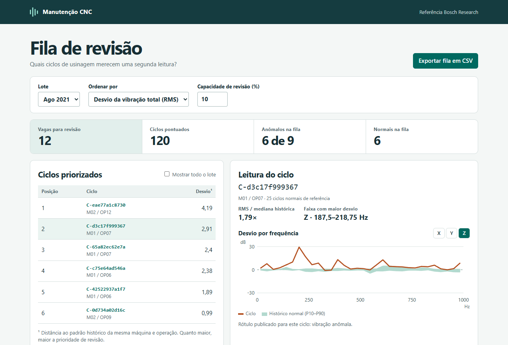

# Triagem de vibração em fresadoras CNC

Se a manutenção consegue revisar só 10% dos ciclos de usinagem, quais deve investigar primeiro? Neste projeto independente, usei os dados públicos de vibração da Bosch Research para testar uma regra simples. Cada ciclo recebe prioridade conforme sua vibração se afasta do histórico da mesma máquina e operação.

**A fila encontrou 11 dos 17 ciclos anômalos em 46 revisões.** Para a mesma capacidade, o sorteio encontraria 1,68 em média. Entre os 46 selecionados, 35 tinham vibração rotulada como normal. Seis anômalos ficaram fora da fila.

[Explorar a demonstração](https://kp-atadsc.github.io/triagem-cnc-bosch/) · [Baixar o Excel](https://github.com/KP-atadsc/triagem-cnc-bosch/raw/refs/heads/main/relatorios/triagem-cnc.xlsx) · [Baixar o Power BI](https://github.com/KP-atadsc/triagem-cnc-bosch/raw/refs/heads/main/relatorios/triagem-cnc.pbix)



Na demonstração, altere a capacidade ou o critério de prioridade e selecione um ciclo para inspecionar os três eixos. O Excel permite auditar a fila registro a registro. O relatório do Power BI tem duas páginas com filtros por período e máquina. [Métricas por lote e critério](relatorios/metricas.csv)

## Resultado observado

A referência usa 1.180 ciclos normais de 2019 e 2020. A avaliação usa os 469 ciclos dos dois períodos de 2021. No cenário de 10%, a regra de vibração total (RMS) teve precisão de 23,9% e cobertura de 64,7%. O cálculo arredonda as vagas para baixo em cada período.

| Período da coleta | Ciclos | Vagas | Anômalos publicados | Anômalos na fila | Normais na fila | Anômalos fora |
|---|---:|---:|---:|---:|---:|---:|
| Fev 2021 | 349 | 34 | 8 | 5 | 29 | 3 |
| Ago 2021 | 120 | 12 | 9 | 6 | 6 | 3 |
| Total | 469 | 46 | 17 | 11 | 35 | 6 |

| Critério nas mesmas vagas | Fev 2021 | Ago 2021 | Total encontrado |
|---|---:|---:|---:|
| RMS contextual | 5 | 6 | 11 |
| Desvio por frequência | 5 | 6 | 11 |
| Maior RMS bruto | 6 | 4 | 10 |
| Sorteio uniforme, valor esperado | 0,78 | 0,90 | 1,68 |

A regra principal usa a vibração total pela facilidade de explicar a prioridade. Os dois critérios contextuais alcançaram a mesma contagem. Dez ciclos anômalos foram selecionados por ambos. O critério espectral também permite investigar em qual eixo e frequência o sinal se afastou do histórico.

## Usar com arquivos HDF5

Na raiz do repositório, com Python 3.11 ou superior, execute os comandos abaixo no PowerShell. As versões utilizadas na verificação foram Python 3.14.7, NumPy 2.5.5 e h5py 3.16.0.

```powershell
python -m venv .venv
.\.venv\Scripts\python -m pip install -r requirements.txt
.\.venv\Scripts\python triagem.py classificar exemplo/lote.csv --saida resultado --capacidade 10
```

Abra `resultado/fila.html`. É possível ajustar a capacidade, trocar de critério, selecionar um ciclo, comparar os eixos e exportar a seleção. O comando também grava `fila.csv`, com todos os ciclos classificados e a indicação de seleção, e `pendencias.csv`, com os registros que exigem correção. Para começar pela análise espectral, acrescente `--metodo espectro`.

Para um novo lote, use um manifesto CSV UTF-8 com as colunas `ciclo,maquina,operacao,arquivo`. Os identificadores de ciclo são únicos no lote. Os caminhos dos arquivos podem ser relativos ao manifesto. Cada HDF5 deve conter `vibration_data`, uma matriz numérica N × 3 com os eixos X, Y e Z, na escala e montagem dos sensores da referência, amostrada a 2.000 Hz. O atributo opcional `frequencia_hz` é verificado quando presente. O manifesto dispensa rótulos.

Cada janela precisa de 8.192 amostras. Um eixo constante, um sinal repetido, um arquivo ilegível ou uma combinação sem referência gera uma pendência separada. A capacidade se aplica aos ciclos que puderam ser pontuados. A equipe precisa tratar as pendências fora dessa fila.

Os 12 ciclos em `exemplo/` são janelas reais da coleta de agosto de 2021, selecionadas pela ordem do identificador de conteúdo. Servem para experimentar a entrada e a saída. A avaliação usa todos os 469 ciclos posteriores.

## Reproduzir a avaliação

```powershell
.\.venv\Scripts\python triagem.py validar --saida validacao
```

O comando recalcula os perfis e as métricas com as características distribuídas em `dados/ciclos.csv.gz`. Ele gera `validacao.html`, `fila.csv`, `metricas.csv` e `referencias.json`. A referência entregue para classificar novos lotes fica em `dados/referencias.json`. As análises e o exemplo funcionam offline após a instalação das dependências.

Para refazer a extração de todos os sinais a partir da revisão oficial, execute `python preparar.py --saida dados/ciclos.csv.gz` no ambiente preparado. O download tem aproximadamente 928 MB. Para reutilizar o ZIP oficial já baixado, acrescente `--zip caminho/arquivo.zip`. A extração verifica o inventário dos arquivos contra os identificadores de conteúdo publicados no Git. O campo `origem` permite rastrear cada linha até seu arquivo HDF5.

## Método e limites

- **Unidade de análise.** Um arquivo representa o registro de vibração de uma operação. O rótulo publicado descreve o comportamento do sinal. Confirmar quebra de ferramenta, refugo ou parada exige o desfecho de manutenção ou de qualidade.
- **Separação temporal.** Das 1.702 gravações, 1.180 registros normais de quatro coletas entre fevereiro de 2019 e agosto de 2020 formam a referência. Os 53 anômalos anteriores ficam fora do ajuste. Os dois lotes de 2021 só entram na avaliação. Todas as janelas centrais têm assinaturas distintas.
- **Comparação justa.** Ambos os métodos usam uma janela central de 4,096 s. Os autores relatam cortes no início e no fim de alguns exemplos anômalos. A duração da gravação, o nome do arquivo, o rótulo e o período ficam fora da pontuação. A seleção e a segmentação prévias feitas pelos autores ainda podem favorecer a detecção.
- **RMS contextual.** O RMS triaxial usa as acelerações após a retirada da média de cada eixo. Para cada combinação de máquina e operação, calcula-se a distância absoluta entre o logaritmo do RMS e a mediana dos logaritmos normais. Divide-se essa distância por 1,4826 × MAD, com piso de 0,20 em escala logarítmica natural. Cada perfil contém de 9 a 42 registros normais.
- **Frequências.** A análise espectral usa janelas de Hann de 1.024 amostras, com 50% de sobreposição. A energia entre 0 e 1.000 Hz é agregada em 32 bandas por eixo, excluído o componente contínuo. O score é a média dos quatro maiores desvios absolutos padronizados. O gráfico mostra a distância à mediana em decibéis e a faixa histórica entre os percentis 10 e 90.
- **Comparadores.** O RMS bruto prioriza o maior nível de vibração sem diferenciar as operações. O sorteio esperado soma, por lote, vagas × anômalos / ciclos. A posição usa a assinatura do sinal como desempate. A pontuação expressa distância à referência, sem calibração como probabilidade de falha.
- **Uso em fábrica.** A base reúne exemplos históricos selecionados e 17 anômalos no teste. Para medir o efeito local, o piloto deve registrar tempo de revisão e diagnóstico confirmado, incluindo uma amostra dos ciclos fora da fila. O projeto não contém estimativa de retorno financeiro.

## Fonte e atribuição

Mohamed-Ali Tnani, Michael Feil e Klaus Diepold. *Smart Data Collection System for Brownfield CNC Milling Machines: A New Benchmark Dataset for Data-Driven Machine Monitoring*. Procedia CIRP 107 (2022), 131–136. [Artigo](https://doi.org/10.1016/j.procir.2022.04.022)

Os dados de vibração foram publicados pela Bosch Research sob CC BY 4.0. As janelas HDF5 de exemplo foram recortadas e as características, classificações e métricas foram calculadas neste projeto independente. [Dados e revisão utilizada](https://github.com/boschresearch/CNC_Machining/tree/d60581d6a3ab6015dcc5488c3d76112bb8e1bcb1) · [Licença dos dados](https://creativecommons.org/licenses/by/4.0/)
